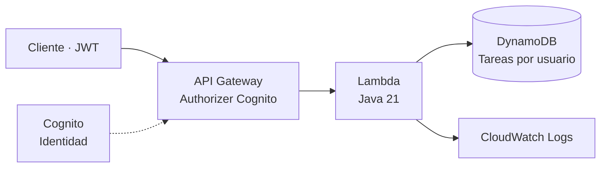

<h1 align="center">AWS Developer Associate</h1>

<p align="center">
  <strong>De Java a aplicaciones en AWS, una semana a la vez.</strong><br />
  Preparación en español · DVA-C03 · Laboratorios serverless · Proyecto progresivo
</p>

<p align="center">
  
  
  
  
</p>


Mi ruta de preparación para **AWS Certified Developer – Associate**: teoría, código y práctica conectados mediante una API de tareas en Java. El objetivo es poder **desarrollar, proteger, desplegar y diagnosticar** una aplicación, además de preparar el examen.

El punto de partida es **Java intermedio y AWS desde cero**, con **4 horas semanales**, recursos preferentemente en español y un presupuesto de laboratorio de **hasta 10 € en total**. Las 12 semanas son un primer ciclo de estudio, sujeto a ampliación según el progreso.

<p align="center">
  <a href="#-empieza-aquí">Empieza aquí</a> ·
  <a href="#-ruta-de-estudio">Roadmap</a> ·
  <a href="#-proyecto-práctico">Proyecto</a> ·
  <a href="#-practica-con-preguntas">Preguntas</a> ·
  <a href="#-costes-y-seguridad">Costes</a>
</p>

> [!NOTE]
> Preparación orientada a **DVA-C03**, con fuentes oficiales consultadas el **11/11/2026**. Revisa la [guía, los enlaces y las notas de vigencia](docs/fuentes.md) antes de reservar. El material de este repositorio es original y no está afiliado a AWS.

---

## 🚀 Empieza aquí

| Paso | Qué hacer | Material |
|---|---|---|
| **1. Preparar** | Revisar conocimientos previos, herramientas, acceso y presupuesto | [Guía de inicio](docs/00-inicio.md) · [Control de costes](docs/costes.md) |
| **2. Estudiar** | Abrir la semana actual y cumplir su criterio de avance | [Roadmap completo](docs/roadmap.md) · [Semana 01](semanas/01.md) |
| **3. Construir** | Ampliar la API a medida que aparecen nuevos conceptos | [Proyecto Java](proyecto/README.md) · [Retos](proyecto/RETOS.md) |
| **4. Comprobar** | Resolver preguntas y explicar las decisiones sin apuntes | [Preguntas explicadas](practica/preguntas.md) · [Tarjetas](practica/tarjetas.tsv) |
| **5. Medir** | Registrar evidencias, errores y resultados antes de reservar | [Progreso](seguimiento/progreso.md) · [Checklist del examen](docs/examen.md) |

Para empezar con el código, necesitas **JDK 21 y Maven**. Para estudiar y resolver preguntas puedes comenzar sin cuenta AWS.

```powershell
git clone https://github.com/eduballesteros/aws-developer-associate.git
cd aws-developer-associate

# Compilar y ejecutar las pruebas locales; no crea recursos en AWS
cd proyecto
mvn clean verify
```

Las herramientas de nube —AWS CLI y SAM CLI— se preparan cuando llegues al despliegue. Encontrarás los requisitos en la [guía de inicio](docs/00-inicio.md).

## 🛤️ Ruta de estudio

| Semanas | Enfoque | Resultado práctico |
|---|---|---|
| [01](semanas/01.md)–[02](semanas/02.md) | Fundamentos, IAM, SDK Java y S3 | Acceso seguro y primeras operaciones desde código |
| [03](semanas/03.md)–[04](semanas/04.md) | Lambda, API Gateway y DynamoDB | API con validación, persistencia y paginación |
| [05](semanas/05.md)–[06](semanas/06.md) | Autenticación, permisos, cifrado y secretos | Identidad verificada y aislamiento entre usuarios |
| [07](semanas/07.md)–[08](semanas/08.md) | Eventos, resiliencia, pruebas y despliegue | Procesamiento asíncrono y cambios reproducibles |
| [09](semanas/09.md)–[10](semanas/10.md) | Observabilidad, optimización e IA | Diagnóstico con evidencias y revisión de cobertura |
| [11](semanas/11.md)–[12](semanas/12.md) | Simulacros y refuerzo | Decisión de presentarse basada en resultados |

El [roadmap detallado](docs/roadmap.md) incluye objetivos, temas, práctica, recursos, horas y criterios de avance por semana.

### Una rutina que cabe en cuatro horas

**60 min de teoría → 90 min de práctica → 45 min de preguntas → 45 min de repaso.**

La limpieza de recursos forma parte de la práctica. Los conceptos se recuperan a **1, 7 y 21 días**; en las semanas finales, el simulacro y su revisión sustituyen la rutina habitual.

## ☁️ Proyecto práctico

**Una API de tareas en Java**, que crece con el estudio: desde una solicitud HTTP hasta la persistencia, la autenticación, el despliegue y el diagnóstico de errores.



| Incluido en la base | Para completar durante el estudio |
|---|---|
| Rutas `POST /tareas` y `GET /tareas` | Integración S3 y URLs prefirmadas |
| Identidad derivada del JWT verificado | SQS, DLQ y recuperación de fallos |
| Validación y escritura condicional | Métricas, alarmas y trazas |
| Listado por usuario y paginación | Canalización de despliegue y rollback |
| Plantilla SAM y pruebas JUnit | Cliente de IA simulado y controles de privacidad |

**Stack:** Java 21 · Maven · AWS SDK for Java v2 · JUnit · AWS SAM · Lambda · API Gateway · DynamoDB · Cognito · CloudWatch Logs.

La base compila y sus **4 pruebas locales** pasan. El despliegue y las integraciones contra AWS quedan por comprobar durante los laboratorios; consulta el [registro de validación](VALIDACION.md).

→ [Instrucciones del proyecto](proyecto/README.md) · [Retos progresivos](proyecto/RETOS.md)

## 🧠 Practica con preguntas

El banco contiene **24 preguntas originales con explicación**, tarjetas de repaso y dos mini-evaluaciones. Puedes leerlo en Markdown o practicar con selección de respuestas desde PowerShell, en la raíz del repositorio:

```powershell
# Seis preguntas aleatorias de todos los dominios
.\practica\Practicar.ps1 -Cantidad 6

# Seis preguntas de seguridad
.\practica\Practicar.ps1 -Dominio 2 -Cantidad 6
```

| Material | Para qué sirve |
|---|---|
| [Preguntas y soluciones](practica/preguntas.md) | Entender la respuesta y descartar alternativas |
| [Tarjetas TSV](practica/tarjetas.tsv) | Recuperar conceptos mediante repaso espaciado |
| [Mini-evaluaciones](practica/mini-tests.md) | Practicar ritmo y localizar dudas |
| [Registro de errores](seguimiento/errores.md) | Convertir cada fallo en un ejercicio corrector |
| [Registro de simulacros](seguimiento/simulacros.md) | Comparar resultados con preguntas nuevas |

Los mini-tests sirven para estudiar; **no sustituyen un simulacro completo**. No se incluyen preguntas filtradas, *exam dumps* ni copias de bancos comerciales.

## 📂 Estructura

```text
aws-developer-associate/
├── docs/          # Inicio, roadmap, cobertura, fuentes, costes y examen
│   └── assets/    # Portada del repositorio
├── semanas/       # 12 guías con práctica y criterios de avance
├── notas/         # Decisiones y conceptos de los cuatro dominios
├── practica/      # Banco explicado, cuestionario y tarjetas
├── proyecto/      # API Java, tests, SAM, eventos y retos
├── seguimiento/   # Progreso, errores, simulacros y gasto
└── VALIDACION.md  # Qué se ha comprobado y qué queda pendiente
```

## 💸 Costes y seguridad

El plan prioriza **materiales gratuitos y pruebas locales**. Los laboratorios tienen un presupuesto personal de **10 € en total**, aparte de la tasa del examen; el coste real depende del uso y de las condiciones de la cuenta.

> [!WARNING]
> Desplegar crea recursos facturables. **AWS Budgets avisa, pero no impone un corte automático de gasto**, y las alertas pueden llegar con retraso. Comprueba créditos y precios, elimina los recursos al terminar y revisa facturación.

- Configura presupuesto y avisos antes del primer despliegue.
- Trabaja con datos ficticios y credenciales temporales; guarda claves y tokens fuera de Git.
- Usa una región y pocas peticiones. Evita servicios con coste continuo para prácticas conceptuales.
- Sigue la limpieza de SAM y comprueba recursos retenidos, logs y artefactos.

→ [Guía de control de costes](docs/costes.md) · [Registro del gasto](seguimiento/costes.md)

## 🎯 Cuándo reservar el examen

La referencia es poder **explicar y aplicar** los conceptos, junto con resultados consistentes en simulacros nuevos y cronometrados. Como criterio de mentoría: alrededor de **80 % en dos simulacros distintos**, sin debilidades persistentes por dominio, más una demostración práctica del proyecto.

Ese porcentaje no equivale a la puntuación escalada de AWS ni garantiza aprobar. Si hace falta, amplía el ciclo entre **4 y 8 semanas** manteniendo el ritmo sostenible.

<details>
<summary><strong>📚 Para el examen y para trabajar con AWS</strong></summary>

Para preparar el examen, prioriza el uso de servicios, permisos, SDK, datos, eventos, pruebas, despliegue, diagnóstico y los contenidos de IA indicados en la guía.

Como ampliación profesional, profundiza después en diseño de plataformas CI/CD, redes, arquitectura empresarial, operación y rendimiento Java avanzado. El proyecto no cubre por sí solo todas las habilidades del examen: utiliza la [matriz de cobertura](docs/cobertura.md).

</details>

→ [Checklist y criterios completos](docs/examen.md) · [Fuentes oficiales](docs/fuentes.md)

---

<p align="center">
  <strong>Eduardo Ballesteros</strong><br />
  <a href="https://www.eduballesteros.es">Portfolio</a> ·
  <a href="https://github.com/eduballesteros">GitHub</a>
</p>
