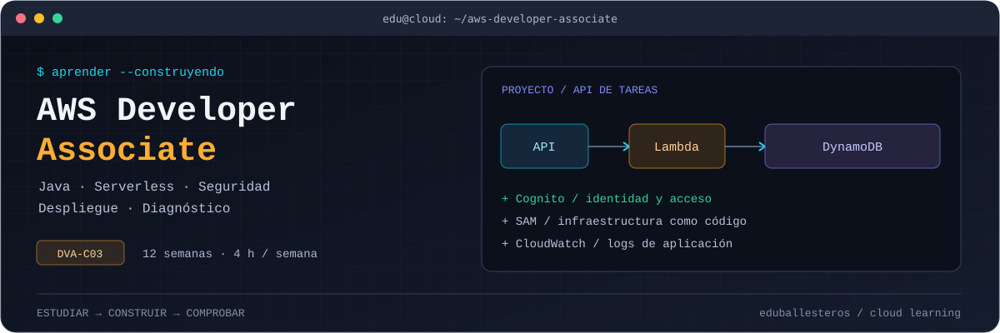
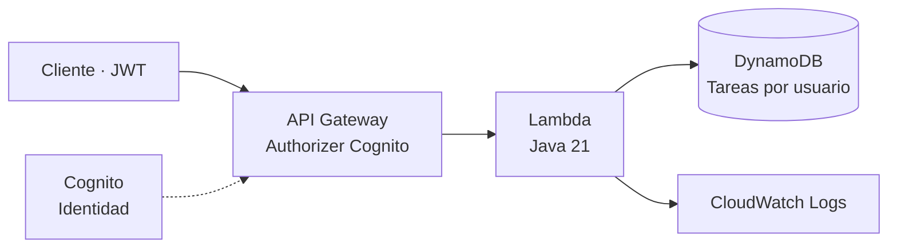

<h1 align="center">AWS Developer Associate</h1>

<p align="center">
  <strong>De Java a aplicaciones en AWS, una semana a la vez.</strong><br />
  DVA-C03 · 12 semanas guiadas · 4 horas semanales · Vídeos y práctica en español
</p>

<p align="center">
  
  
  
  
</p>



Mi ruta de preparación para **AWS Certified Developer – Associate**, organizada para saber qué hacer en cada sesión: **qué vídeo ver, qué leer, qué construir y cómo comprobar lo aprendido**. La teoría se conecta con una API de tareas en Java y con ejercicios de seguridad, despliegue y diagnóstico.

El punto de partida es **Java intermedio y AWS desde cero**, con **4 horas semanales**, recursos preferentemente en español y un presupuesto de laboratorio de **hasta 10 € en total**. Las 12 semanas son un primer ciclo de estudio, sujeto a ampliación según el progreso.

<p align="center">
  <a href="#-empieza-aquí">Empieza aquí</a> ·
  <a href="#-ruta-de-estudio">Roadmap</a> ·
  <a href="#-vídeos-para-cada-etapa">Vídeos</a> ·
  <a href="#-proyecto-práctico">Proyecto</a> ·
  <a href="#-practica-con-preguntas">Preguntas</a> ·
  <a href="#-costes-y-seguridad">Costes</a>
</p>

> [!NOTE]
> Preparación orientada a **DVA-C03**, con fuentes oficiales consultadas el **11/11/2026**. Revisa la [guía, los enlaces y las notas de vigencia](docs/fuentes.md) antes de reservar. El material de este repositorio es original y no está afiliado a AWS.

---

## 🚀 Empieza aquí

**Tu siguiente paso es abrir la [semana 01](semanas/01.md) y realizar la primera sesión.** Cada guía tiene tareas, tiempos, entrega y criterio de avance. Si ya has empezado, continúa desde la semana en la que puedas demostrar el resultado, no desde el último vídeo visto.


| Paso | Qué hacer | Material |
|---|---|---|
| **1. Preparar** | Revisar conocimientos previos, herramientas, acceso y presupuesto | [Guía de inicio](docs/00-inicio.md) · [Control de costes](docs/costes.md) |
| **2. Seguir las sesiones** | Ver o leer el recurso asignado y realizar las tareas en orden | [Roadmap completo](docs/roadmap.md) · [Vídeos seleccionados](docs/youtube.md) |
| **3. Construir** | Ampliar la API a medida que aparecen nuevos conceptos | [Proyecto Java](proyecto/README.md) · [Retos](proyecto/RETOS.md) |
| **4. Comprobar** | Resolver preguntas y explicar las decisiones sin apuntes | [Preguntas explicadas](practica/preguntas.md) · [Tarjetas](practica/tarjetas.tsv) |
| **5. Registrar y avanzar** | Guardar la entrega, revisar pendientes y decidir el siguiente paso | [Plantilla semanal](seguimiento/plantilla-semanal.md) · [Progreso](seguimiento/progreso.md) |

Para empezar con el código, necesitas **JDK 21 y Maven**. Para estudiar y resolver preguntas puedes comenzar sin cuenta AWS.

```powershell
git clone https://github.com/eduballesteros/aws-developer-associate.git
cd aws-developer-associate

# Compilar y ejecutar las pruebas locales; no crea recursos en AWS
cd proyecto
mvn clean verify
```

Las herramientas de nube —AWS CLI y SAM CLI— se preparan cuando llegues al despliegue. Encontrarás los requisitos en la [guía de inicio](docs/00-inicio.md).

## 🛤️ Ruta de estudio

| Semana | Qué trabajarás | Entrega de la semana |
|---|---|---|
| [01 · Fundamentos y acceso](semanas/01.md) | Cuenta, MFA, IAM, regiones y presupuesto | Equipo preparado y acceso seguro |
| [02 · SDK Java y S3](semanas/02.md) | Credenciales, objetos y URL prefirmada | Ejemplo S3 o mock documentado |
| [03 · API y Lambda](semanas/03.md) | Petición HTTP, handler y validación | Compilación y un test adicional |
| [04 · DynamoDB](semanas/04.md) | Claves, consultas, paginación y duplicados | Modelo de datos y casos de prueba |
| [05 · Cognito y autorización](semanas/05.md) | JWT, dos usuarios y primer laboratorio integrado | Comprobación de aislamiento y limpieza |
| [06 · Cifrado y secretos](semanas/06.md) | TLS, KMS, configuración y datos sensibles | Política ficticia y revisión de seguridad |
| [07 · Eventos y resiliencia](semanas/07.md) | Colas, reintentos, DLQ e idempotencia | Consumidor local con duplicados y fallos |
| [08 · Pruebas y despliegue](semanas/08.md) | SAM, artefactos, canalizaciones y rollback | Build fallido/restaurado y diseño de fases |
| [09 · Observabilidad](semanas/09.md) | Logs, métricas, alarmas y diagnóstico | Informe de incidente y propuesta de alarma |
| [10 · IA y cobertura](semanas/10.md) | Asistencia de IA, privacidad y temas pendientes | Fake de IA, pruebas y matriz de lagunas |
| [11 · Primer diagnóstico](semanas/11.md) | Simulacro nuevo y análisis de errores | Resultado por dominio y plan de refuerzo |
| [12 · Evaluación final](semanas/12.md) | Segundo simulacro y explicación del proyecto | Decisión razonada: reservar o reforzar |

→ [Roadmap con objetivos, recursos, horas y criterios](docs/roadmap.md)

### Cuatro sesiones, cuatro horas

En las **semanas 1–10**, sigue este reparto:

| Sesión | Tiempo | Qué haces |
|---|---:|---|
| **1 · Comprender** | 60 min | Vídeo o lectura asignados y notas de decisiones |
| **2 · Construir** | 60 min | Ejercicio o cambio en el proyecto |
| **3 · Comprobar** | 60 min | 30 min de práctica + 30 min de preguntas |
| **4 · Consolidar** | 60 min | 15 min de corrección + 45 min de repaso y registro |

La limpieza está incluida en la práctica. Reparte parte del repaso al día siguiente y recupera conceptos a **1, 7 y 21 días**, sin sumar horas. Las **semanas 11–12** tienen bloques propios para simulacros, corrección y decisión final.

Al cerrar la semana, completa la [plantilla de evidencia](seguimiento/plantilla-semanal.md) y actualiza [progreso](seguimiento/progreso.md), [errores](seguimiento/errores.md) y [costes](seguimiento/costes.md). Si una configuración consume el tiempo disponible, registra el bloqueo y amplía esa semana.

## 🎬 Vídeos para cada etapa

La guía prescribe fragmentos o bloques de estudio; no necesitas terminar todos los cursos. Los vídeos acompañan los ejercicios y las lecturas oficiales.

| Etapa | Recurso seleccionado | Cómo usarlo |
|---|---|---|
| Semanas 1–2 | [AWS desde cero · Jean Reyes](https://www.youtube.com/watch?v=Rr-0tZ9lPj8) | Primer contacto con AWS; seguir el bloque indicado en cada semana |
| Semanas 3–4 y 9 | [Serverless desde cero · Yoelvis Mulen](https://www.youtube.com/watch?v=MxSF2GPz4HE) | Fragmentos de Lambda, API Gateway, DynamoDB y CloudWatch |
| Apoyo Java | [API Java serverless · Luigi Code](https://www.youtube.com/watch?v=Uy-4bknuppA) | Consultar backend si necesitas otro ejemplo; omitir Angular |
| Semanas 5–6 | [Amazon Cognito · AWS Security Users Group LatAm](https://www.youtube.com/watch?v=DdSCAYm_5KE) | Autenticación, integración y permisos |
| Semana 8 | [SAM paso a paso · Marcia Villalba](https://www.youtube.com/watch?v=4yh1A3reAiQ) | Desarrollo, pruebas locales y despliegue |
| Apoyo CI/CD | [CodePipeline y CodeBuild · Programación en español](https://www.youtube.com/watch?v=PUI3VPw0Uv8) | Complemento opcional dentro del tiempo de teoría |

Las semanas **7 y 10** priorizan documentación oficial para cubrir los huecos de la selección. Los vídeos son de creadores y comunidades independientes; los ejemplos antiguos requieren contrastar versiones, consola, precios y permisos.

**No se ha verificado un curso completo de YouTube en español que cubra todo DVA-C03.** Consulta [fechas, marcas de tiempo y límites de cada recurso](docs/youtube.md).

## ☁️ Proyecto práctico

**Una API de tareas en Java**, que crece con el estudio: desde una solicitud HTTP hasta la persistencia, la autenticación, el despliegue y el diagnóstico de errores.



| Incluido en la base | Ejercicios y ampliaciones |
|---|---|
| Rutas `POST /tareas` y `GET /tareas` | Integración S3 y URLs prefirmadas |
| Identidad derivada del JWT verificado | SQS, DLQ y recuperación de fallos |
| Validación y escritura condicional | Métricas, alarmas y trazas |
| Listado por usuario y paginación | Canalización de despliegue y rollback |
| Plantilla SAM y pruebas JUnit | Cliente de IA simulado y controles de privacidad |

**Stack:** Java 21 · Maven · AWS SDK for Java v2 · JUnit · AWS SAM · Lambda · API Gateway · DynamoDB · Cognito · CloudWatch Logs.

El mínimo semanal incluye simulaciones locales; SQS real, canalización completa, canary y observabilidad avanzada son ampliaciones cuando dispongas de más tiempo y presupuesto. Identifica siempre qué has simulado y qué has ejecutado en AWS.

La base compila y sus **4 pruebas locales** pasan. El despliegue y las integraciones contra AWS quedan por comprobar durante los laboratorios; consulta el [registro de validación](VALIDACION.md).

→ [Instrucciones del proyecto](proyecto/README.md) · [Retos progresivos](proyecto/RETOS.md)

## 🧠 Practica con preguntas

El banco contiene **24 preguntas originales con explicación**, tarjetas de repaso y dos mini-evaluaciones. Puedes leerlo en Markdown o practicar con selección de respuestas desde PowerShell, en la raíz del repositorio:

```powershell
# Seis preguntas aleatorias de todos los dominios
.\practica\Practicar.ps1 -Cantidad 6

# Seis preguntas de seguridad
.\practica\Practicar.ps1 -Dominio 2 -Cantidad 6
```

| Material | Para qué sirve |
|---|---|
| [Preguntas y soluciones](practica/preguntas.md) | Entender la respuesta y descartar alternativas |
| [Tarjetas TSV](practica/tarjetas.tsv) | Recuperar conceptos mediante repaso espaciado |
| [Mini-evaluaciones](practica/mini-tests.md) | Practicar ritmo y localizar dudas |
| [Registro de errores](seguimiento/errores.md) | Convertir cada fallo en un ejercicio corrector |
| [Registro de simulacros](seguimiento/simulacros.md) | Comparar resultados con preguntas nuevas |

Los mini-tests sirven para estudiar; **no sustituyen un simulacro completo**. No se incluyen preguntas filtradas, *exam dumps* ni copias de bancos comerciales.

## 📂 Estructura

```text
aws-developer-associate/
├── docs/          # Inicio, roadmap, vídeos, cobertura, costes y examen
│   └── assets/    # Portada del repositorio
├── semanas/       # 12 guías con práctica y criterios de avance
├── notas/         # Decisiones y conceptos de los cuatro dominios
├── practica/      # Banco explicado, cuestionario y tarjetas
├── proyecto/      # API Java, tests, SAM, eventos y retos
├── seguimiento/   # Plantilla semanal, progreso, errores y gasto
└── VALIDACION.md  # Qué se ha comprobado y qué queda pendiente
```

## 💸 Costes y seguridad

El plan prioriza **materiales gratuitos y pruebas locales**. Los laboratorios tienen un presupuesto personal de **10 € en total**, aparte de la tasa del examen; el coste real depende del uso y de las condiciones de la cuenta.

> [!WARNING]
> Desplegar crea recursos facturables. **AWS Budgets avisa, pero no impone un corte automático de gasto**, y las alertas pueden llegar con retraso. Comprueba créditos y precios, elimina los recursos al terminar y revisa facturación.

- Configura presupuesto y avisos antes del primer despliegue.
- Trabaja con datos ficticios y credenciales temporales; guarda claves y tokens fuera de Git.
- Usa una región y pocas peticiones. Evita servicios con coste continuo para prácticas conceptuales.
- Sigue la limpieza de SAM y comprueba recursos retenidos, logs y artefactos.

→ [Guía de control de costes](docs/costes.md) · [Registro del gasto](seguimiento/costes.md)

## 🎯 Cuándo reservar el examen

La referencia es poder **explicar y aplicar** los conceptos, junto con resultados consistentes en simulacros nuevos y cronometrados. Como criterio de mentoría: alrededor de **80 % en dos simulacros distintos**, sin debilidades persistentes por dominio, más una demostración práctica del proyecto.

Los simulacros completos pueden requerir acceso de pago. Las semanas 11–12 incluyen una alternativa formativa si no encuentras uno dentro de tu presupuesto; esa alternativa deja la evaluación independiente pendiente.

Ese porcentaje no equivale a la puntuación escalada de AWS ni garantiza aprobar. Si hace falta, amplía el ciclo entre **4 y 8 semanas** manteniendo el ritmo sostenible.

<details>
<summary><strong>📚 Para el examen y para trabajar con AWS</strong></summary>

Para preparar el examen, prioriza el uso de servicios, permisos, SDK, datos, eventos, pruebas, despliegue, diagnóstico y los contenidos de IA indicados en la guía.

Como ampliación profesional, profundiza después en diseño de plataformas CI/CD, redes, arquitectura empresarial, operación y rendimiento Java avanzado. El proyecto no cubre por sí solo todas las habilidades del examen: utiliza la [matriz de cobertura](docs/cobertura.md).

</details>

→ [Checklist y criterios completos](docs/examen.md) · [Fuentes oficiales](docs/fuentes.md)

---

<p align="center">
  <strong>Eduardo Ballesteros</strong><br />
  <a href="https://www.eduballesteros.es">Portfolio</a> ·
  <a href="https://github.com/eduballesteros">GitHub</a>
</p>
