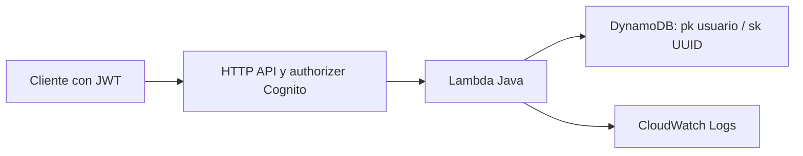

# Proyecto: API de tareas en Java
## Qué funciona en la base
POST/GET, JSON, validación, paginación, escritura condicional y aislamiento por sub del JWT.
SAM define HTTP API con authorizer Cognito, tabla DynamoDB bajo demanda, Lambda Java 21 y logs.
No implementa todavía SQS, S3, alarmas, trazas, IA real ni canalización de despliegue: son retos.

## Arquitectura

Este es un laboratorio, no una aplicación lista para producción. Falta, entre otros, autorización por scopes,
límites de tráfico, protección adicional, métricas y pruebas de integración automatizadas.
La escritura condicional devuelve 409 al repetir ID: evita sobrescritura, pero NO reproduce la respuesta de
una solicitud anterior. Diseña idempotencia completa antes de añadir efectos secundarios como cobros.

## Local primero
Desde esta carpeta:
```powershell
mvn clean verify
```
JUnit no usa AWS. Prueba reglas de entrada, no integración ni authorizer.
Los clientes AWS y la infraestructura deben comprobarse después con un laboratorio controlado.
Las dependencias están fijadas para reproducibilidad, no se afirma que sean las últimas;
revisa actualizaciones y avisos antes de reutilizar en producción.

## Despliegue opcional (genera costes)
Lee ../docs/costes.md. Comprueba perfil, cuenta y región.
```powershell
aws sts get-caller-identity --profile estudio
sam validate --lint
sam build
sam deploy --guided --profile estudio --region eu-west-1
```
Nombre sugerido de pila: aws-dev-estudio. Revisa cambios y confirma IAM solo tras leer la plantilla.
SAM puede pedir confirmar la API; todas las rutas de esta base usan JWT.
El bucket de artefactos puede generar cargos y persistir. No se activa ningún despliegue automáticamente.
Si hay error de build por herramientas o runtime, consulta fuentes.md; no cambies a un runtime obsoleto.

## Usuario de prueba
En Cognito crea un usuario de laboratorio con contraseña permanente mediante las herramientas administrativas
de consola, en el pool de Outputs. No habilites SMS. No guardes contraseña ni tokens en archivos del repo.
Para obtener el ID token sin poner contraseña en el historial de comandos, ejecuta desde esta carpeta:
```powershell
$authLab = & .\scripts\token.ps1
$jwtLab = $authLab.AuthenticationResult.IdToken
```
El script pide ClientId, usuario y contraseña; usa un archivo temporal restringido a tu usuario y lo elimina en finally.
No actives transcripción ni compartas la salida. Si aparece un challenge, resuélvelo antes de seguir.
El ID token sirve para este laboratorio sin scopes personalizados; estudia access tokens y scopes como mejora.

## Probar API
Con ID token y URL de Outputs, mantén todo en variables de sesión:
```powershell
$apiLab = Read-Host 'ApiUrl de Outputs'
# $jwtLab se obtiene con scripts/token.ps1; no lo publiques ni lo guardes en archivos.
$headersLab = @{ Authorization = "Bearer $jwtLab" }
$bodyLab = @{ id = [guid]::NewGuid().ToString(); titulo = 'Repasar IAM' } | ConvertTo-Json
Invoke-RestMethod -Uri $apiLab -Method Post -Headers $headersLab -ContentType 'application/json' -Body $bodyLab
Invoke-RestMethod -Uri $apiLab -Headers $headersLab
```
Para página siguiente: usa ?cursor= con siguienteCursor no vacío.
Prueba: sin token debe fallar antes de Lambda; body inválido=400; repetir ID=409.
Crea segundo usuario y verifica que no vea tareas del primero aunque reenvíe su ID por el body.
Los eventos JSON incluidos SIMULAN el authorizer: no validan JWT y nunca deben exponerse como puerta de acceso.

## Limpieza
```powershell
sam delete --stack-name aws-dev-estudio --region eu-west-1 --profile estudio
```
Comprueba recursos retenidos/externos y facturación. Se borran usuarios y datos ficticios de la pila.
Sigue RETOS.md para continuar por semanas.
